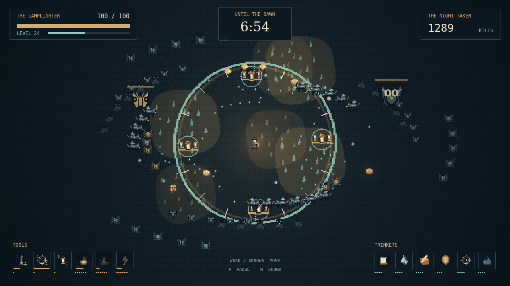

# Wick

One lamplighter. A city swallowed by night. A little light that everything wants. In **Wick**, you only walk: your tools strike, orbit, scatter, and burn on their own. Pick your path through the crowd and keep the flame alive for ten minutes.

The first moths are fragile. They will not be the last things to find you. Bats sweep in, beetles close the gaps, and the heavy shapes behind them keep coming. Gather the gems they leave and choose one gift at each level: another tool, a useful trinket, or a stronger version of something you already trust.

Six tool slots and six trinket slots make every choice matter. Carry a fully mastered tool beside its matching trinket, open a chest left by an elite, and watch it become something stranger. A slash can feed your flame. An orbit of lanterns can become permanent. The Almanac holds the things you have yet to meet.

Then the Dark arrives. You do not have to defeat the night; you have to outlast it. Keep moving, leave yourself a way through, and hold on until dawn.

